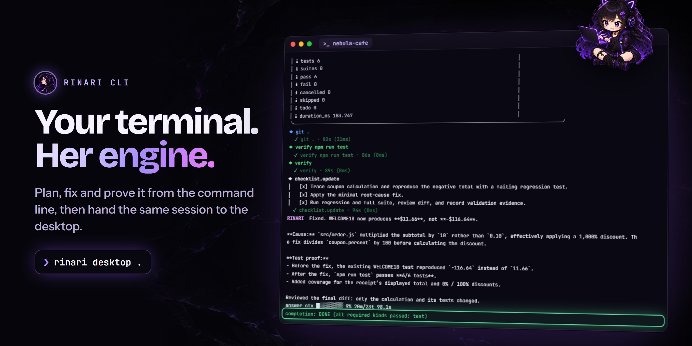
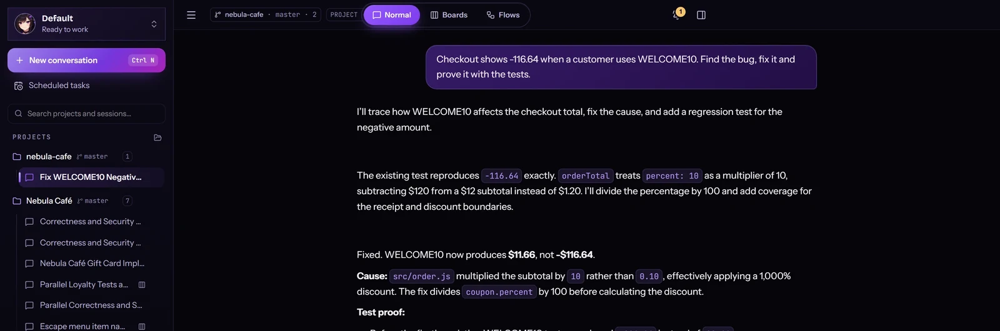
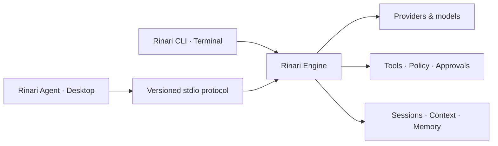

<div align="center">

<a href="https://rinari.ai"></a>

# Rinari CLI

**Your terminal. Her engine.**<br>
Ask, plan, fix and prove it from the command line, then hand the same session to the desktop.

[](https://github.com/Xainner/Rinari-CLI/actions/workflows/ci.yml)
[](LICENSE)

[](https://github.com/Xainner/Rinari-Agent/releases/latest)

[Install](#install) · [First steps](#first-steps) · [Commands](#commands) · [Desktop handoff](#start-in-the-terminal-continue-on-the-desktop) · [Docs](#documentation) · [rinari.ai](https://rinari.ai)

</div>

<br>

This repository holds **Rinari Engine** and its **terminal client**. The engine owns execution, sessions, model routing, approvals, credentials and state. The terminal and [Rinari Agent](https://github.com/Xainner/Rinari-Agent), the desktop app, are two clients of that same engine, not two separate agents.

<sub>The banner frames a real session: the terminal content is the replay of a recorded take with Rinari 0.3.1.</sub>

## What it does

**Tell her what's broken.** She reads the repository before touching anything, reproduces the bug with a failing test, applies the fix, runs the suite again and reports what passed. In the session above:

```text
◆ checklist.update
│   [x] Trace coupon calculation and reproduce the negative total with a failing regression test.
│   [x] Apply the minimal root-cause fix.
│   [x] Run regression and full suite, review diff, and record validation evidence.
RINARI  Fixed. WELCOME10 now produces **$11.66**, not **-$116.64**.
completion: DONE (all required kinds passed: test)
```

`completion: DONE` appears only when the required verification kinds actually passed. It reports what was checked; it doesn't make generated code correct by itself.

| Capability | What it brings |
| :--- | :--- |
| **Modes with permissions** | `ask`, `plan` and `review` run read-only; `agent` and `run` use a workspace profile. Risky actions wait for your approval. |
| **Repository tools** | Files, shell, Git, repository search, tree-sitter and LSP, managed background processes and PTY sessions. |
| **Beyond the repo** | Browser automation, HTTP, MCP (stdio and remote), OpenAPI operations, plugins and hooks. |
| **Context that lasts** | CHAT and PROJECT sessions, durable memory, context pins, a repository index and compaction for long work. |
| **Delegated work** | Specialist agents and parallel subagents with their own model, objective and budget. |
| **Evidence** | Checklists, verification records, checkpoints and `undo`, artifacts and an event trace for every session. |

## Install

**With Rinari Agent (Windows).** The [desktop installer](https://github.com/Xainner/Rinari-Agent/releases/latest) ships the engine and the CLI. Tick **Add Rinari CLI to PATH** during setup (it is off by default) and `rinari` works from any terminal.

**With uv** (Python 3.11+, [uv](https://docs.astral.sh/uv/) and Git):

```bash
uv tool install "rinari @ git+https://github.com/Xainner/Rinari-CLI"
```

To match a desktop release exactly, pin the engine revision it ships with (see `engine-manifest.json` in [Rinari Agent](https://github.com/Xainner/Rinari-Agent)), for example `…/Rinari-CLI@2a94168` for Rinari Agent 0.3.1.

**Keep it current.** `rinari update` updates the desktop app and the CLI to the latest published release:

```bash
rinari update            # app + CLI, asks before applying
rinari update --check    # only report (exit 1 when something is pending)
rinari update --cli-only
```

## First steps

```bash
rinari setup     # connect a provider and pick a model (re-running never erases records)
rinari doctor    # local diagnostics; never touches credentials or state
cd my-project
rinari           # detects the project and opens a session
```

Then give her a focused task:

```bash
rinari ask "Where is configuration validated?"
rinari plan "Add JSON export to the report command"
rinari agent "Checkout shows -116.64 with WELCOME10. Find the bug, fix it and prove it with the tests."
rinari review "Check today's changes for regressions"
```

These are separate invocations, not an automatic plan-to-build pipeline: read the result and decide the next step.

## Start in the terminal, continue on the desktop

Every session lives in the engine, so the desktop can pick it up exactly where the terminal left it:

```bash
rinari desktop .                    # open this project in Rinari Agent
rinari desktop . --session <id>     # continue this session there
```



Set `RINARI_AGENT_BIN` (or pass `--binary`) if the desktop executable isn't found. `rinari code` remains a compatibility alias; `rinari agent` runs a task in the terminal and doesn't open the desktop.

## Commands

`rinari --help` and `rinari <command> --help` describe your installed version. The [command reference](docs/commands.md) covers the full contract.

| You want to… | Commands |
| :--- | :--- |
| Work on a task | `ask` · `plan` · `agent` · `run` · `review` · `chat` |
| Continue or stop work | `resume` · `session` · `stop` · `undo` · `checkpoint` |
| Verify and inspect the work | `verify` · `tasks` · `flow` · `trace` |
| Profiles, projects and memory | `bundles` (profiles as workspaces) · `project` · `init` · `memory` · `context` · `index` |
| Models and providers | `setup` · `providers` · `provider` · `models` · `model` · `agents` · `vision` |
| Extend her | `skills` · `mcp` · `plugins` · `api` · `hooks` · `tools` · `schedule` |
| Policy and safety | `trust` · `permissions` · `approvals` · `sandbox` · `network` · `secrets` · `profiles` |
| Diagnose | `status` · `doctor` · `logs` · `metrics` · `artifacts` · `version` |
| Move data | `export` · `import` · `update` |
| Connect a client | `desktop` · `engine` |

## Control is part of the workflow

Her personality is never her permission system. Every tool call passes through validation and policy, with approvals and sandboxing where they apply, and project trust decides which project-local extensions load.

- **Choose the scope.** Read-only and workspace work have different permission profiles ([tool contract](docs/tools.md), [read-scope semantics](docs/tools.md#alcance-de-lectura-en-plan-y-review)).
- **External content is input, not authority.** Files, web pages and tool results never grant new permissions.
- **Know where data goes.** A local CLI doesn't make cloud providers or integrations offline. Keep secrets out of prompts, logs and repositories (`rinari secrets` stores references; values are never shown).
- **Review before relying on results.** Check diffs, tests and artifacts. Checkpoints help you recover; they don't replace review.

## The engine protocol

```bash
rinari engine --stdio
```

A versioned NDJSON protocol over stdio, with requests, responses and session-scoped events, for compatible clients such as Rinari Agent. It is a machine transport, not an interactive chat.



## Where the project stands

Rinari is moving toward a stable release. [TODO.md](TODO.md) lists the open work that is still real, including broader platform validation and more adversarial tests. Provider behavior varies: a model may not support tool calling, vision or reasoning levels, and remote models may charge for usage.

## Development

```bash
git clone https://github.com/Xainner/Rinari-CLI.git
cd Rinari-CLI
uv sync
uv run rinari doctor
uv run pytest tests/unit -q
uv run ruff check .
uv run ruff format --check .
```

From a source checkout, prefix commands with `uv run`. Run `uv run pytest` for the full suite and follow [AGENTS.md](AGENTS.md).

## Documentation

| Guide | What you'll find |
| :--- | :--- |
| [Commands](docs/commands.md) | Workflows, options and persistence semantics |
| [Tools](docs/tools.md) · [Skills](docs/skills.md) | Execution capabilities and reusable procedures |
| [Harness](docs/harness.md) · [Architecture](docs/stack.md) | Runtime ownership and subsystem contracts |
| [Desktop protocol](docs/desktop/README.md) | The engine/client contract |
| [Troubleshooting](docs/troubleshooting.md) | Diagnostics, configuration and recovery |
| [rinari.ai/docs](https://rinari.ai/docs/) | Install, connect a model and work with Rinari |

Found a bug? [Open an issue](https://github.com/Xainner/Rinari-CLI/issues) with your version (`rinari version`), the steps to reproduce it and redacted diagnostics. Never include credentials or private project content.

---

<div align="center">

**Less context switching. More deliberate work.**

[Install](#install) · [Rinari Agent](https://github.com/Xainner/Rinari-Agent) · [rinari.ai](https://rinari.ai) · [MIT License](LICENSE)

</div>
